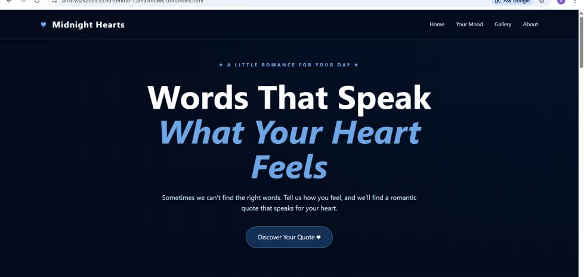
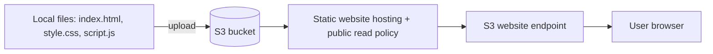

# Static Website Hosting on Amazon S3 - "Midnight Hearts"

A mood-based romantic quote website (HTML, CSS, JavaScript) deployed with **Amazon S3 static website hosting** - serverless, low-cost and highly available.

## Features
- Landing page with a "Discover Your Quote" call to action
- Pick a mood (Happy, Sad, ...) to get a matching quote
- "Another Quote" and "Favorite" buttons
- Responsive, dark-themed UI

## Deployment steps
1. Create an S3 bucket in `eu-central-1` (Frankfurt).
2. Upload `index.html`, `style.css`, `script.js`.
3. Enable **Static website hosting** and set `index.html` as the index document.
4. Add a bucket policy allowing public `s3:GetObject` on the objects.
5. Open the S3 website endpoint and test.

## Challenges
- Correct MIME types for `.html`, `.css`, `.js`
- Granting public read to the required objects only
- Setting `index.html` as the default document

## Tech stack
Amazon S3 | HTML5 | CSS3 | JavaScript

## Repository contents
- `images/` - architecture, user-flow diagram and screenshots
- `report/` - full project report

## Future scope
CloudFront for HTTPS and global caching, Route 53 custom domain, Lambda + DynamoDB for saved favorites, CI/CD deployment.

## Author
**Atharva Vadage** - [GitHub](https://github.com/Atharva72218)
